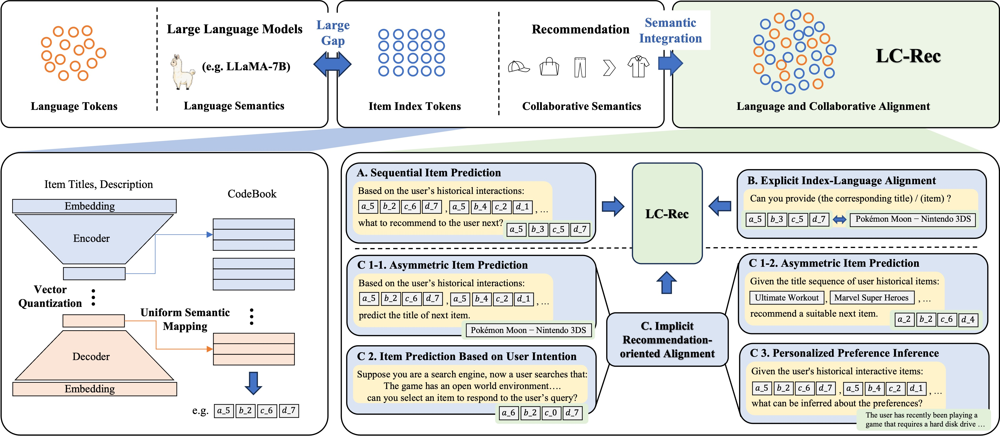

# LC-Rec

Esta es la implementación oficial en PyTorch para el artículo:

> [Adapting Large Language Models by Integrating Collaborative Semantics for Recommendation](https://ieeexplore.ieee.org/abstract/document/10597986/)

## Visión general

Proponemos **LC-Rec**, un nuevo enfoque para integrar semánticas **L**ingüísticas y **C**olaborativas con el fin de mejorar los LLM en sistemas de **Recomendación**. Para abordar la gran brecha entre las semánticas lingüísticas modeladas por los LLM y las semánticas colaborativas implícitas en los sistemas de recomendación, presentamos dos contribuciones principales en dos aspectos. Para la indexación de elementos, diseñamos un método de cuantización vectorial basado en aprendizaje con un mapeo semántico uniforme, el cual puede asignar identificadores significativos y no conflictivos (llamados índices de elemento) para los elementos. Para el ajuste de alineación, proponemos una serie de tareas de ajuste diseñadas específicamente para mejorar la integración de las semánticas colaborativas en los LLM. Nuestras tareas de ajuste fino obligan a los LLM a integrar profundamente las semánticas lingüística y colaborativa (caracterizadas por los índices de elemento aprendidos), logrando así una adaptación efectiva a los sistemas de recomendación.



## Requisitos

```
torch==1.13.1+cu117
accelerate
bitsandbytes
deepspeed
evaluate
peft
sentencepiece
tqdm
transformers
```

## Checkpoints del modelo

Los pesos delta para los tres conjuntos de datos se pueden descargar desde Hugging Face Hub ([Instruments](https://huggingface.co/bwzheng0324/lc-rec-instruments-delta), [Arts](https://huggingface.co/bwzheng0324/lc-rec-arts-delta), [Games](https://huggingface.co/bwzheng0324/lc-rec-games-delta)). Después de descargarlos, puede sumar nuestros deltas a los pesos originales de LLaMA para obtener los pesos de LC-Rec:

1. Obtenga los pesos originales de [LLaMA](https://huggingface.co/huggyllama/llama-7b).
2. Utilice los siguientes scripts para obtener los pesos de LC-Rec aplicando nuestro delta.

```shell
python -m convert/merge_delta.py \
    --base-model-path /path/to/llama-7b \
    --target-model-path /path/output/lc-rec \
    --delta-path bwzheng0324/lc-rec-games-delta
```

## Conjunto de datos

Utilizamos tres conjuntos de datos en nuestro artículo, los cuales han sido subidos todos a [Google Drive](https://drive.google.com/drive/folders/1RcJ2M1l5zWPHYuGd9l5Gibcs5w5aI3y6?usp=sharing) 

## Entrenamiento

Los scripts detallados para los tres conjuntos de datos se encuentran en `run.sh`:

```shell
DATASET=Games
BASE_MODEL=huggyllama/llama-7b
DATA_PATH=./data
OUTPUT_DIR=./ckpt/$DATASET/

torchrun --nproc_per_node=8 --master_port=23324 finetune.py \
    --base_model $BASE_MODEL \
    --output_dir $OUTPUT_DIR \
    --dataset $DATASET \
    --data_path $DATA_PATH \
    --per_device_batch_size 8 \
    --gradient_accumulation_steps 2 \
    --learning_rate 5e-5 \
    --epochs 4 \
    --weight_decay 0.01 \
    --save_and_eval_strategy epoch \
    --deepspeed ./config/ds_z3_bf16.json \
    --bf16 \
    --only_train_response \
    --tasks seqrec,item2index,index2item,fusionseqrec,itemsearch,preferenceobtain \
    --train_prompt_sample_num 1,1,1,1,1,1 \
    --train_data_sample_num 0,0,0,100000,0,0 \
    --index_file .index.json


cd convert
nohup ./convert.sh $OUTPUT_DIR >convert.log 2>&1 &
cd ..
```

## Pruebas

Prueba con una sola GPU:

```shell
DATASET=Games
DATA_PATH=./data
CKPT_PATH=./ckpt/$DATASET/
RESULTS_FILE=./results/$DATASET/result.json

python test.py \
    --gpu_id 0 \
    --ckpt_path $CKPT_PATH \
    --dataset $DATASET \
    --data_path $DATA_PATH \
    --results_file $RESULTS_FILE \
    --test_batch_size 1 \
    --num_beams 20 \
    --test_prompt_ids all \
    --index_file .index.json
```

Prueba con múltiples GPUs:

```shell
DATASET=Games
DATA_PATH=./data
CKPT_PATH=./ckpt/$DATASET/
RESULTS_FILE=./results/$DATASET/result.json

torchrun --nproc_per_node=8 --master_port=23324 test_ddp.py \
    --ckpt_path $CKPT_PATH \
    --dataset $DATASET \
    --data_path $DATA_PATH \
    --results_file $RESULTS_FILE \
    --test_batch_size 1 \
    --num_beams 20 \
    --test_prompt_ids all \
    --index_file .index.json
```

## Agradecimientos

La implementación se basa en [HuggingFace](https://github.com/huggingface/transformers).

Por favor, cite el siguiente artículo como referencia si utiliza nuestro código o los conjuntos de datos procesados.
```bigquery
@inproceedings{zheng2024adapting,
  title={Adapting large language models by integrating collaborative semantics for recommendation},
  author={Zheng, Bowen and Hou, Yupeng and Lu, Hongyu and Chen, Yu and Zhao, Wayne Xin and Chen, Ming and Wen, Ji-Rong},
  booktitle={2024 IEEE 40th International Conference on Data Engineering (ICDE)},
  pages={1435--1448},
  year={2024},
  organization={IEEE}
}
```
